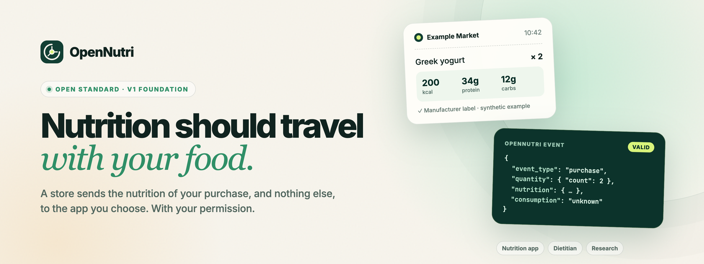
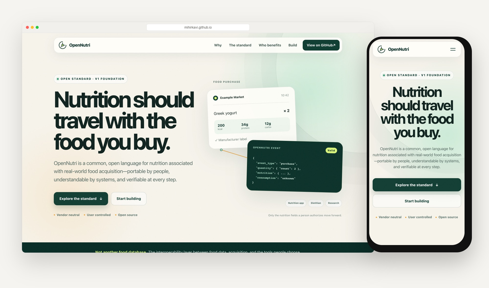
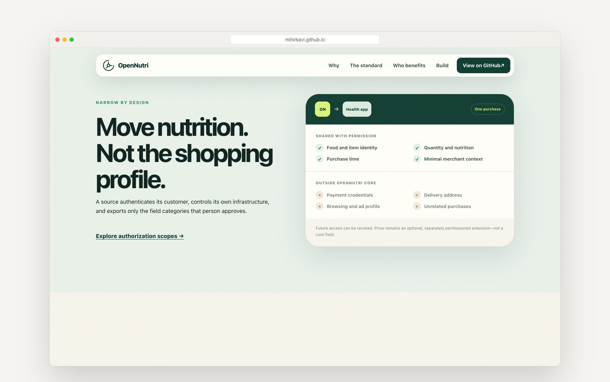
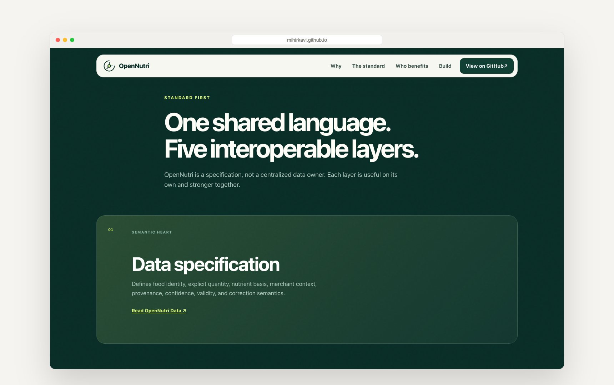
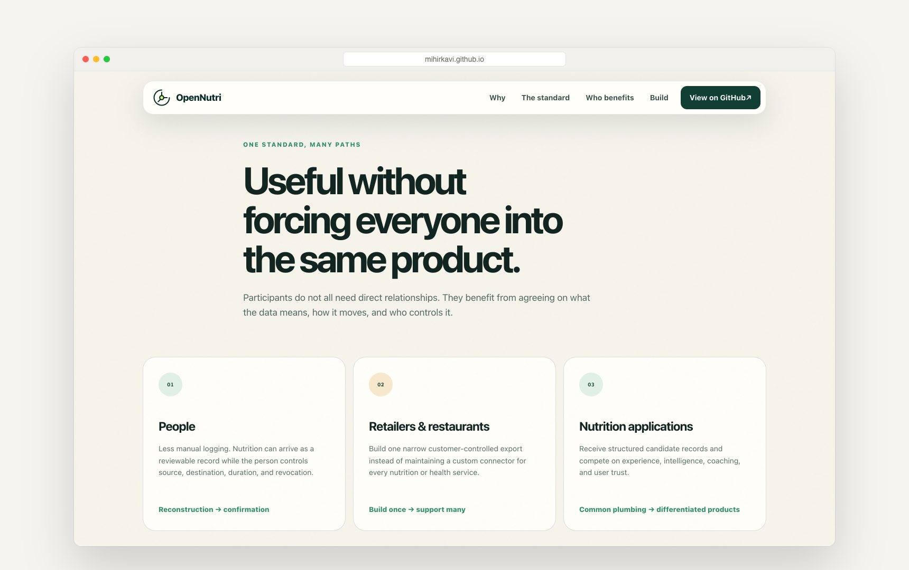
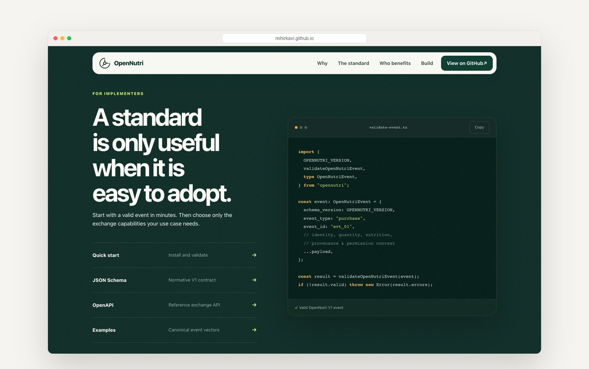
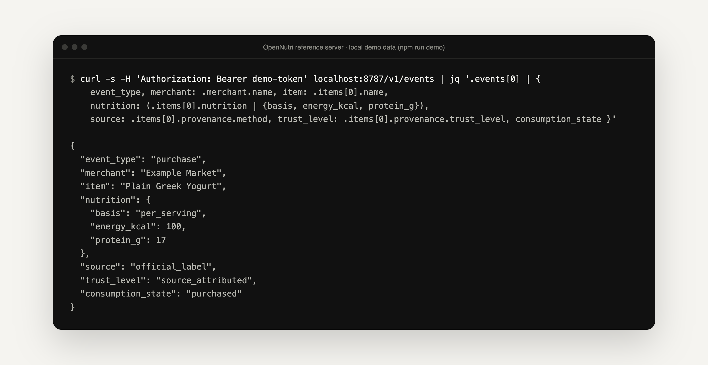

<p align="center">
  <a href="https://mihirkavi.github.io/open-nutrition-transaction/">
    <picture>
      <source media="(prefers-color-scheme: dark)" srcset=".github/assets/banner-dark.png">
      
    </picture>
  </a>
</p>

<p align="center">
  <strong>Take your nutrition wherever you choose.</strong><br>
  OpenNutri is an open standard that lets a store or restaurant send the nutrition of <em>your</em> purchase, and nothing else, to the app <em>you</em> pick.
</p>

<p align="center">
  <a href="https://mihirkavi.github.io/open-nutrition-transaction/"><strong>Website</strong></a> ·
  <a href="spec/data.md"><strong>Data spec</strong></a> ·
  <a href="spec/exchange.md"><strong>Exchange spec</strong></a> ·
  <a href="schema/event.schema.json"><strong>JSON Schema</strong></a> ·
  <a href="docs/quick-start.md"><strong>Quick start</strong></a> ·
  <a href="CONTRIBUTING.md"><strong>Contribute</strong></a>
</p>

<p align="center">
  <a href="LICENSE"></a>
  
  
  <a href="https://github.com/mihirkavi/open-nutrition-transaction/actions/workflows/ci.yml"></a>
</p>

<p align="center">
  <a href="https://mihirkavi.github.io/open-nutrition-transaction/"></a>
</p>

## Why OpenNutri

Your grocery store or favourite restaurant already knows exactly what you bought, and often its nutrition. Yet if you track what you eat, you still type it into a health app by hand. Every app that wants that data has to build its own connector to every store, and every store has to decide how much of your shopping profile to hand over.

**OpenNutri gives everyone one neutral, narrow format.** A food provider exports a small, optionally signed *nutrition event* for one purchase. You decide which app receives it, which fields, for how long, and you can revoke it. Payment details, addresses, loyalty data and unrelated purchases are never part of the standard.

```text
food provider ─▶ OpenNutri event you authorize ─▶ the app you choose
```

<table>
  <tr>
    <td width="33%" valign="top">
      <h3>🧺 Nutrition, not your profile</h3>
      Only food identity, quantity, nutrition and minimal merchant context. Payment credentials, addresses, browsing and unrelated purchases stay outside the core.
    </td>
    <td width="33%" valign="top">
      <h3>🔑 You hold the key</h3>
      Narrow scopes, one-time or continuing access, a visible history window and revocation. Pre-ticked boxes and deceptive consent screens are prohibited.
    </td>
    <td width="33%" valign="top">
      <h3>🏷️ Honest about origin</h3>
      Every value says where it came from and how much to trust it, what its basis is (per serving, per 100 g…) and that a purchase is <em>not</em> proof you ate it.
    </td>
  </tr>
</table>

> **Integrate once. Let nutrition travel.**

## A quick tour

<table>
  <tr>
    <td width="50%" valign="top">
      
      <h4>Narrow by design</h4>
      What moves with permission, and what never leaves the store: payment, address, ad profile and unrelated purchases.
    </td>
    <td width="50%" valign="top">
      
      <h4>One shared language</h4>
      A specification, not a data owner. Data, Exchange, provenance, authorization and conformance layers.
    </td>
  </tr>
  <tr>
    <td width="50%" valign="top">
      
      <h4>Everyone benefits differently</h4>
      People log less by hand, food businesses build one export, and apps compete on experience.
    </td>
    <td width="50%" valign="top">
      
      <h4>Easy to adopt</h4>
      Validate an event in a few lines, then add only the exchange features your use case needs.
    </td>
  </tr>
</table>

<sub>Screenshots of the live <a href="https://mihirkavi.github.io/open-nutrition-transaction/">OpenNutri website</a>, captured on 26 October 2026. All example data is synthetic.</sub>

## What is in the box

| | Piece | What it gives you | Status |
| --- | --- | --- | --- |
| 📄 | **[OpenNutri Data](spec/data.md)** | Food events, item identity, quantity, nutrition basis, provenance, confidence, corrections, historical validity | ✅ V1 draft |
| 🔁 | **[OpenNutri Exchange](spec/exchange.md)** | Authorization scopes, consent, revocation, delivery, signatures, idempotency, replay protection | ✅ V1 draft |
| 🧾 | **[JSON Schemas](schema)** | The normative, machine-readable contract (`event.schema.json` and its parts) | ✅ |
| 🌐 | **[OpenAPI](openapi/openapi.yaml)** | A REST reference API for listing events and managing webhook subscriptions | ✅ |
| 🧪 | **[Examples](examples)** | Grocery, restaurant, refund, correction and signed events | ✅ |
| 🟦 | **[TypeScript validator](src/index.ts)** | `validateOpenNutriEvent`, types and constants | ✅ Tested in CI |
| 🖥️ | **[Reference server](reference-server)** | A dependency-free local API serving the grocery example | 🧪 Demo only |
| 🐍 | **[Python](sdk/python) and [Swift](sdk/swift)** | A small envelope validator (Python) and a Codable model (Swift) | 🧪 Minimal |
| 🎨 | **[Demo screens](demo)** | Static merchant, consent and receiving-app pages | 🧪 Conceptual |
| 🧭 | **[ONIPs](onips)** | The OpenNutri Improvement Proposal process | ✅ |

## Quick start

Requires Node.js 22 or newer.

```bash
git clone https://github.com/mihirkavi/open-nutrition-transaction && cd open-nutrition-transaction
npm install
npm test        # builds the validator and runs the contract and site tests
npm run demo    # starts the reference server on http://127.0.0.1:8787
```

Then, in another terminal, ask the reference server for the events you are "authorized" to see (demo token, synthetic data):

<p align="center">
  
</p>

Validate events in your own code:

```ts
import { validateOpenNutriEvent, type OpenNutriEvent } from "opennutri";

const result = validateOpenNutriEvent(event);
if (!result.valid) throw new Error(result.errors.join("\n"));
```

See [docs/quick-start.md](docs/quick-start.md) for delivery examples and the [examples](examples) folder for complete events.

## Who it is for

| If you are… | Start with |
| --- | --- |
| A **retailer or restaurant** | [Retailer guide](docs/retailer-guide.md) · the smallest useful export |
| A **POS or ordering platform** | [POS guide](docs/pos-guide.md) · integrate once for all your merchants |
| A **nutrition or fitness app** | [App developer guide](docs/app-developer-guide.md) · receiving and showing events |
| A **food manufacturer** | [Manufacturer guide](docs/manufacturer-guide.md) · label data and provenance |
| A **dietitian or healthcare tool** | [Healthcare guide](docs/healthcare-guide.md) · context with the person's permission |

## Trust, in plain words

- `self_declared`: supplied by a person or an app.
- `source_attributed`: linked to a named source, such as a manufacturer's label.
- `verified`: cryptographically attributable to a source (Ed25519 signatures in V1).

Estimates are labelled. Every value states its basis, such as per item, per serving, per 100 g or the purchased quantity, so nobody has to guess.

## Honest status

OpenNutri is an **early open standard**. This repository holds the V1 foundation and reference tooling:

- **No food business or app has adopted it in production yet.** The [adoption roadmap](docs/adoption-roadmap.md) describes how that could happen.
- The **reference server is a local demo**: one fixed example event, a single demo token, scopes not enforced, and webhook subscriptions held in memory without delivery.
- The TypeScript validator checks the **shape** of signatures; it does not verify Ed25519 signatures cryptographically.
- The Python and Swift SDKs are **minimal starting points**, and the demo screens are **static concept pages** that send no data.
- The package is not published to npm; install it from GitHub.
- Implementations are responsible for applicable privacy, healthcare, consumer protection, accessibility and retention requirements. This project is not legal or medical advice.

<details>
<summary><strong>Neutrality and scope</strong></summary>
<br>

OpenNutri does not require a retailer to share data with ReceiptCal or any other particular application. A person chooses the destination. ReceiptCal may be an early reference consumer, while competing nutrition, dietitian, healthcare and research applications participate on equal terms.

OpenNutri V1 standardizes nutrition portability. It does not standardize medical diagnosis, personalized treatment, universal food identity, payment data, advertising profiles or a centralized consumer database.

</details>

<details>
<summary><strong>Project map</strong></summary>
<br>

| Path | What it is |
| --- | --- |
| [`MISSION.md`](MISSION.md), [`PRINCIPLES.md`](PRINCIPLES.md) | Purpose and boundaries |
| [`spec/`](spec) | Data, Exchange, provenance, authorization and conformance |
| [`schema/`](schema) | Composable JSON Schemas |
| [`openapi/openapi.yaml`](openapi/openapi.yaml) | REST reference API |
| [`examples/`](examples) | Grocery, restaurant, refund, correction and signed events |
| [`src/`](src), [`dist/`](dist) | TypeScript validator source and build |
| [`sdk/`](sdk) | TypeScript, Python and Swift usage surfaces |
| [`reference-server/`](reference-server) | Dependency-free example API |
| [`demo/`](demo) | Merchant, consent and receiving-app concept screens |
| [`docs/`](docs) | Implementation guides, architecture and adoption roadmap |
| [`onips/`](onips) | OpenNutri Improvement Proposal process |
| [`site/`](site) | The GitHub Pages website |

</details>

## Contributing

OpenNutri gets better with every retailer, app builder, dietitian and researcher who reviews it.

- Read [CONTRIBUTING.md](CONTRIBUTING.md) and [GOVERNANCE.md](GOVERNANCE.md).
- Propose a change to the standard through an [ONIP](onips/README.md).
- Report security problems privately as described in [SECURITY.md](SECURITY.md).

## License

Licensed under [Apache-2.0](LICENSE), including an explicit patent grant. See [NOTICE](NOTICE).

<p align="center">
  <br>
  <br>
  <sub><strong>OpenNutri</strong> · Integrate once. Let nutrition travel.</sub>
</p>
